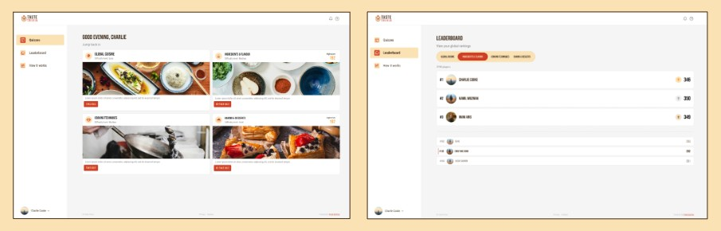
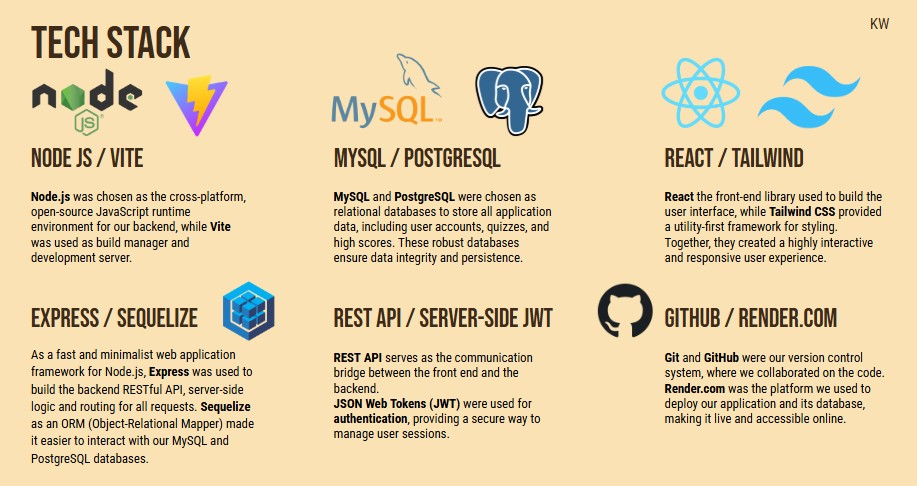

# Taste Trivia: Quiz for Foodies - Test your tastebuds and challenge your culinary knowledge!

Taste Trivia is a modern web application built with **React** for the frontend and a **Sequelize/Node/PostgreSQL/MySQL**
backend. A full-stack trivia dashboard that tests your knowledge of all things food. Compete against others to climb the leaderboards and prove you're the ultimate food trivia master.

## Features

- **React-powered frontend** for a dynamic user experience
- **Sequelize ORM** for seamless database interactions
- **PostgreSQL/MySQL backend** for efficient data storage
- **Node.js server** for handling API requests
- **Full-stack integration** with streamlined development workflow

## User Story

AS A passionate home cook, I WANT to be able to test my food knowledge on different topics SO THAT I can learn new facts, challenge my friends, and earn bragging rights on a leaderboard.

## Installation

Follow these steps to install and set up project locally:

### 1. Clone the Repository

```sh
git clone https://github.com/KamilWo/step8up-final-quiz-for-foodies.git
cd step8up-final-quiz-for-foodies
```

### 2. Create the Database

Open a terminal and enter MySQL or Psql:

```sh
mysql -u root -p
```
or
```sh
psql -u root -p
```

Enter your password when prompted, then create the database by running:

```sh
source db/quiz_db.sql;
quit;
```

### 3. Install Dependencies

Run the following command in the root directory to install dependencies for both server and client:

```sh
npm install
```

### 4. Set up Environment Variables

Copy `.env.example` files in the `client` and `server` folders, to create `.env` files. In the server folder, update
your MySQL username and password

### 5. Seed the Database (Optional)

If you want to populate the database with sample data, run:

```sh
npm run seed
```

### 6. Start the Application

Run the following command to start the development server:

```sh
npm run dev
```

The application should now be running locally.

## UI/UX Design

To ensure a smooth development process, we first created high-fidelity mockups in Figma to serve as a clear blueprint for the dashboard's screens. This strategy helped us achieve our MVP (Minimum Viable Product) goals quickly and efficiently by speeding up development and reducing miscommunications and mismatched expectations.



## Tech Stack



## Usage

- Open your browser and navigate to `http://localhost:5173` to access the application.
- Explore features such as ...
- The Sequelize/NodeJS backend can be accessed via `http://localhost:3001`

## Contributing

Feel free to submit issues and pull requests to improve the project. Contributions are welcome!

Live Link: https://step8up-final-quiz-for-foodies.onrender.com/

Github: https://github.com/KamilWo/step8up-final-quiz-for-foodies

## License

This project is licensed under the **GPLv3 License**.
